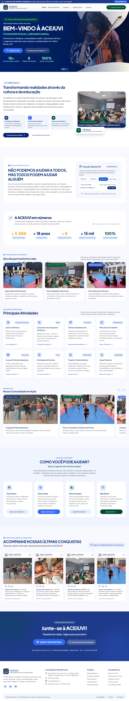

# ACEJUVI — Site institucional

Projeto de site institucional da **Associação Centro Juvenil Pela Vida (ACEJUVI)**, com páginas responsivas e integração com WordPress por meio de um plugin próprio.

Este repositório apresenta o código e os materiais do projeto para portfólio. É uma cópia independente: não possui conexão de publicação com o site em produção.

## Prévia visual

## O projeto

- Página inicial com apresentação institucional, trajetória e informações da organização.
- Página Quem Somos.
- Página do projeto ZumZumZum.
- Plugin WordPress para exibição do conteúdo por shortcodes.
- Integração de formulários com recursos do WordPress e links de contato por WhatsApp.
- Imagens, documentos institucionais e referências de design incluídos nos arquivos locais.

## Tecnologias

HTML, CSS, JavaScript, PHP, WordPress, Tailwind CSS via CDN e Google Fonts.

## Organização

| Pasta | Conteúdo |
| --- | --- |
| `acejuvi-shortcode-plugin/` | Plugin WordPress, páginas, imagens e documentos do projeto |
| `avaliacao_stitch_acejuvi/` | Referência da página inicial, HTML, design e captura de tela |
| `pagina-quem-somos-source/` | Referência e fontes da página Quem Somos |
| `tmp-zumzumzum-source/` | Referência e fontes da página ZumZumZum |

A versão identificada no plugin desta cópia é **1.0.71**. Os ZIPs históricos de instalação não estão incluídos; os arquivos-fonte atuais estão preservados.

## Visualização

A captura acima permite conhecer a proposta visual diretamente no GitHub. Para inspecionar o HTML, abra `acejuvi-shortcode-plugin/public/landing.html` no navegador. Alguns recursos usam serviços externos e precisam de internet; formulários e integrações WordPress dependem de uma instalação WordPress.

O GitHub exibe os arquivos como código. Este repositório não configura GitHub Pages, automações ou publicação na hospedagem.

## Uso em ambiente de desenvolvimento

Para testar a integração, use uma instalação WordPress separada do site em produção. As instruções e os shortcodes disponíveis constam em `acejuvi-shortcode-plugin/readme.txt`.

## Créditos e materiais

O cabeçalho do plugin identifica a autoria como **MKTDumont** e declara a licença **GPL-2.0-or-later**. Marcas, fotografias e documentos institucionais mantêm os direitos de seus respectivos titulares; essa declaração não amplia a licença desses materiais.
